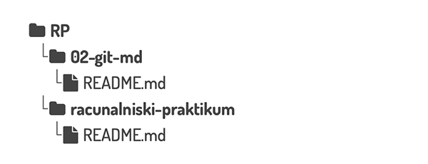
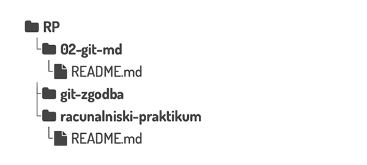

# Git

`````{admonition} Programska oprema
:class: important
- [ukazna vrstica](namestitev:ukazna),
- [Visual Studio Code](namestitev:vscode).
`````

## Git, orodje za nadzor različic

Zelo poenostavljeno povedano sistemi za nadzor različic zapisujejo spremembe v datoteke na tak način, da lahko kadarkoli prikličemo poljubno različico. 
V resnici nam ponujajo še mnogo več, saj med drugim omogočajo:

- povrniti datoteke ali kar celoten projekt v prejšnje stanje, 
- primerjati, kako so se s časom zgodile spremembe, 
- pogledati, kdo je nazadnje kaj spremenil,
- sodelovanje na projektu, kjer lahko več ljudi hkrati ureja iste datoteke.

Taki sistemi so najbolj razširjeni pri programiranju, vendar so koristni tudi drugje.
Na primer, ob zaključevanju diplomskih del brez ustrezne podpore hitro nastanejo datoteke kot `diploma-koncna.tex`, `diploma-koncna2.tex`, `diploma (zadnja).tex`, `diploma (oddana).tex`, itd.

Tekom študija boste pri nekaterih predmetih (upamo pa, da tudi za lastne potrebe) uporabljali orodje [Git](https://git-scm.com), ki je najbolj razširjeno sodobno orodje. 
Urejevalnik [Visual Studio Code](https://code.visualstudio.com/) ima dobro razvito [podporo za Git](https://code.visualstudio.com/docs/editor/versioncontrol#_git-support).

Za začetek si poglejmo nekaj osnovnih izrazov, ki jih bomo uporabljali:

- _delovno drevo_ (angl. _working tree_) je imenik z vsemi datotekami projekta, na katerem smo vklopili nadzor različic.
- _sprememba_ (angl. _commit_) je osnovna enota nadzora različic, ki vsebuje zabeleženo stanje datotek skupaj s časom, avtorjem, opisom, podatkih o predhodnih spremembah in podobno. Vsaka sprememba tvori neko smiselno celoto, na primer popravek enega hrošča, dodatek nove funkcionalnosti, ...
- _repozitorij_ (angl. _repository_ ali _repo_) je zbirka vseh zabeleženih sprememb.
- _klon_ (angl. _clone_) je ena izmed kopij repozitorija. Ena se običajno nahaja na javnem strežniku (za primer lahko pogledate gradiva za Uvod v programiranje na [GitHubu](https://github.com/matijapretnar/uvod-v-programiranje)), vsak, ki dela na projektu pa ima eno kopijo še v delovnem drevesu (skrito v imeniku `.git`).

## 1. naloga: prvi koraki z Git-om

Pri tej vaji boste ponovno uporabili ukazno vrstico - vsi ukazi so pospremljeni z razlagami, da ne boste imeli občutka, da samo ponavljate magične uroke za učiteljem.

### Pripravite svoj računalnik za delo

<!-- Nasvet za samostojni Git Bash (zunaj VSCode) na Windows:
Preverite, ali za kopiranje in lepljenje v programu Git Bash delujeta običajni bližnjici.
Če ne, bosta morda delovali Ctrl+Ins in Shift+Ins.
-->

`````{admonition} Nasvet za pomikanje po ukazni vrstici
:class: tip
Po ukazni vrstici se lahko premikate s puščicami na tipkovnici.
Za pomikanje po trenutni vrstici lahko uporabite puščici <kbd>←</kbd> in <kbd>→</kbd>.
Za pomikanje po zgodovini ukazov lahko uporabite puščici <kbd>↑</kbd> in <kbd>↓</kbd>.
`````

Sledite navodilom za [nastavitve `git`-a](git:nastavitve), da si nastavite uporabniške nastavitve ter SSH ključ.

### Klonirajte svoj prvi repozitorij na računalnik

1. Izberite imenik na disku, kjer boste imeli spravljene repozitorije, s katerimi boste delali pri tem predmetu; predlagamo vam, da kar v imenik `RP` (to bodo predpostavila tudi navodila v nadaljevanju).
2. V ukazni vrstici se premaknite v ta imenik.
3. Kopirajte naslov vašega repozitorija (ki ste ga ustvarili in oddali v 1. domači nalogi) z GitHub-a: 
    - Odprite stran z vašim repozitorijem v brskalniku in kliknite na zeleni gumb _Code_.
    - Izberite zavihek _Local_, pod njim pa zavihek _SSH_.
    - Kopirajte naslov, ki izgleda takole nekako:
      `git@github.com:⟨moje-uporabnisko-ime⟩/⟨moj-repozitorij⟩.git`
4. V ukazni vrstici napišite ukaz:
   ```shell
   git clone ⟨naslov-iz-zgornje-tocke⟩
   ```
   Pri prvem kloniranju vas `git` morda vpraša, če zaupate GitHubu (_The authenticity of host can't be established._).
   V tem primeru je treba napisati _yes_, preden se kloniranje izvede.
5. Preverite, da vam je uspelo: podobno kot na vajah prejšnji teden poženite ukaz `ls`, da izpišete vsebino trenutnega imenika. Videti bi morali tudi ime vašega repozitorija.
6. Če datotek `besedilo.txt` in `besedilo2.txt` še niste pobrisali, to lahko naredite zdaj v ukazni vrstici. Ukaz je `rm *.txt`, ampak preden ga poženete, razmislite, kaj naredi.
7. Oglejte si še vsebino svojega imenika `RP` in jo primerjajte s spodnjo.

:::{figure-md} slika:vsebina-imenika-kloniranje


&nbsp; Važno je, kam ste klonirali repozitorij `racunalniski-praktikum`.
:::


## 2. naloga: Git zgodba

`````{admonition} Nastavitve uporabnika
:class: attention
Če še niste [uredili nastavitev uporabnika za Git](git:nastavitve-uporabnika), to naredite zdaj.
Če pridete do prvega _commita_ preden uredite nastavitve, vam bo Git prijazno povedal, da morate to narediti. 
V tem primeru sledite navodilom, ki se izpišejo, na koncu pa morate še enkrat pognati `git commit -m "⟨sporočilo⟩"`
`````

Pojdite na repozitorij [git-zgodba](https://github.com/racunalniski-praktikum/git-zgodba) in sledite navodilom.
Bodite pozorni na to, kam boste klonirali repozitorij.
Priporočamo, da v isti imenik, v katerega ste že klonirali svoj prvi repozitorij.

:::{figure-md} slika:vsebina-imenika-zgodba


&nbsp; Važno je, kam ste klonirali repozitorij `git-zgodba`.
:::

### Urejanje datotek iz ukazne vrstice

1. Poženete program `nano`, ki mu podate ime datoteke, ki jo želite urediti.
   ```shell
   nano ⟨ime-datoteke⟩
   ```
   Spomnite se, da vam imen datotek ni vedno treba pisati. Ponavadi je dovolj prvih nekaj črk, nakar 
   stisnete tipko <kbd>Tab</kbd>, da dopolnite ime.
2. S puščicami <kbd>↑↓←→</kbd> se lahko premikate po besedilu, lahko tudi pišete ali brišete znake, kot običajno.
3. Spremembe shranite z bližnjico <kbd>Ctrl</kbd>+<kbd>O</kbd> (stisnite vnašalko, da potrdite ime datoteke, v katero želite pisati).
4. Program zaprete z bližnjico <kbd>Ctrl</kbd>+<kbd>X</kbd>.

Če želite samo ustvariti novo datoteko, uporabite program `touch`:
```shell
touch ⟨ime-datoteke⟩
```

## Dodatni viri

* [Git Time](https://git.bradwoods.io/), spletna igrica za spoznavanje Gita, ki jo je razvil Brad Woods.
* [Learn Git Branching](https://learngitbranching.js.org), nekoliko naprednejša spletna igra za spoznavanje Gita s poudarkom na delu z vejami.
* [Oh My Git!](https://ohmygit.org), igra za spoznavanje gita, ki kmalu predstavi, kako lahko na datotekah sodeluje več avtorjev.

## Še nerazporejeno gradivo

<!-- Delovni razdelek: tu je zbrano vse, česar novo 1. in 2. poglavje nista prevzeli
     iz starega 1. poglavja (Urejevalnik in ukazna vrstica) in starega 2. poglavja
     (Git in Markdown), pa ne sodi v zgornje razdelke. Besedilo je prepisano dobesedno.
     Razdelek pobrišemo, ko gradivo razporedimo. -->

### Iz stare 3. naloge 1. poglavja: življenje brez miške

Koraki, ki jih 3. naloga novega 1. poglavja ni prevzela.
V uvodu naloge je bilo kot primer, kaj vnaprej poiskati v dokumentaciji, navedeno vprašanje "kako se v VSCode besedilo z bližnjico spremeni v same velike črke?" (novo poglavje ima namesto tega odpiranje imenika).

 4. Poskrbite, da bo kodiranje nastavljeno na `UTF-8` (glejte spodaj desno v statusno vrstico v VSCode).
 5. Napišite vsaj tri vrstice poljubnega besedila.
 6. Pomaknite se na začetek vrste s čim manj pritiskov tipk.
 7. Pomaknite se naprej za eno besedo s čim manj pritiskov tipk.
 8. Zbrišite vrsto s čim manj pritiskov tipk.

Koraki 9–11 (shranite, zaprite, ponovno odprite) so v novem poglavju.

12. Ustvarite novo datoteko, shranite jo kot `besedilo2.txt` in vanjo prekopirajte vaše prvotno besedilo.
13. Pretvorite besedilo v `besedilo2.txt` tako, da bo zapisano iz SAMIH VELIKIH ČRK.
14. Shranite datoteko `besedilo2.txt`.

### Iz stare 1. naloge 2. poglavja: README

Točka iz seznama "Domača naloga" v predlogi README; novo 1. poglavje jo je izpustilo, ker Git pride na vrsto šele v tem poglavju:

```markdown
- [ ] Sinhronizirajte spremembe z repozitorijem na GitHubu: najprej naredite `commit` (smiselno sporočilo bi bilo npr. "dopolni README z vajami za Markdown"), nato pa še `push`.
```

Iz navodil za urejanje, točka 2, stavek o bližnjicah iz domače naloge (anketa po starem 1. tednu):
"Vključite še bližnjice, ki ste jih zabeležili v domači nalogi."

Iz točke 8 o dostopu do datoteke od doma, v novem 1. poglavju izpuščena stavka:
"Shranjevanje na USB ključek odsvetujemo. Za malo naprednejše uporabnike seveda priporočamo Git."
