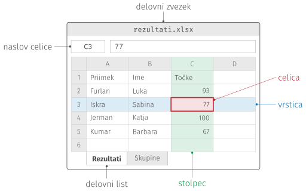
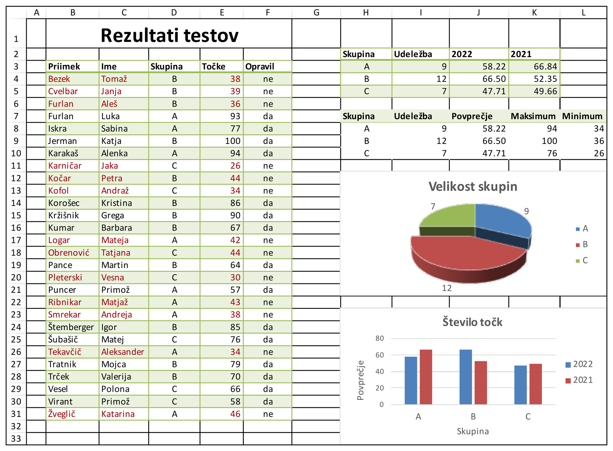

# Preglednice

`````{admonition} Programska oprema
:class: important
- [Excel](namestitev:microsoft)
`````

Excel je program za delo s preglednicami (angl. _spreadsheet_); podobno delujeta Numbers na macOS in Google Sheets v spletnem brskalniku.
Datoteka programa Excel je delovni zvezek (angl. _workbook_) z enim ali več delovnimi listi (angl. _worksheet_).
Dele preglednice kaže {numref}`slika %s <slika:deli-preglednice>`.

:::{figure-md} slika:deli-preglednice
:width: 70%
:align: center


&nbsp; Deli preglednice
:::

Excel ste najverjetneje že kdaj uporabljali, zato predpostavljamo, da poznate začetna poglavja [vodiča po Excelu](https://support.microsoft.com/en-us/office/what-is-excel-94b00f50-5896-479c-b0c5-ff74603b35a3) do vključno poglavja o diagramih (angl. _Charts_), od poglavja _Formulas & functions_ pa le razdelek _Overview of formulas in Excel_.
Še posebej pomembno je, da znate opravila, ki jih na kratko povzemamo spodaj.

**Vrstice, stolpci in listi.**
Vrstico ali stolpec vstavite ali izbrišete tako, da desno kliknete njegovo oznako (številko vrstice ali črko stolpca) in izberete _Insert_ ali _Delete_.
Širino stolpca spremenite tako, da povlečete desni rob njegove oznake; z dvoklikom na ta rob se stolpec razširi ravno toliko, da je vsa vsebina vidna.
Nov list dodate z gumbom `+` ob zavihkih listov na dnu okna, preimenujete ga z dvoklikom na zavihek, vrstni red listov pa spremenite tako, da zavihek povlečete.

**Izbiranje in premikanje celic.**
Obseg celic izberete tako, da povlečete od ene vogalne celice do nasprotne, ali tako, da kliknete prvo celico, nato pa s pritisnjeno tipko <kbd>Shift</kbd> še zadnjo.
S pritisnjeno tipko <kbd>Ctrl</kbd> (🍎 <kbd>Cmd</kbd>) izbiri dodate celice, ki niso sosednje.
Klik na oznako vrstice ali stolpca izbere celo vrstico ali stolpec.
Izbiro premaknete tako, da povlečete njen rob, ko se kazalec spremeni v štiri puščice.
Formule, ki se sklicujejo na premaknjene celice, se pri tem popravijo same.

**Diagrami.**
Izberite podatke skupaj z naslovi stolpcev in na zavihku _Insert_ izberite vrsto diagrama.
Ko je diagram izbran, se na traku pojavita zavihka _Chart Design_ in _Format_.
Naslove osi, legendo in oznake podatkov dodate na zavihku _Chart Design_ z ukazom _Add Chart Element_, podatke, ki jih diagram prikazuje, pa spremenite z ukazom _Select Data_.

**Zapolnjevanje celic.**
Izbrana celica ali obseg celic ima v spodnjem desnem kotu kvadratek (angl. _fill handle_).
Ko ga povlečete, Excel izbiro razširi na nove celice: posamezno vrednost kopira, zaporedje, na primer `1` in `2` ali datum, pa nadaljuje.
Formula se pri tem prilagodi novemu mestu, kot opisuje razdelek _Delo s podatki_.
Dvoklik na kvadratek zapolni stolpec navzdol do zadnje vrstice s podatki v sosednjem stolpcu.

**Sklici v formulah.**
Formula se začne z znakom `=`.
Na celico se v njej sklicujete z njenim naslovom, na primer `B3`, na obseg celic pa z naslovoma zgornje leve in spodnje desne celice, ločenima z dvopičjem, na primer `B2:D10`.
Naslova vam ni treba tipkati: med pisanjem formule kliknite celico ali povlecite čez obseg.
Na celico na drugem listu se sklicujete z imenom lista in klicajem, na primer `Podatki!B3`; če ime lista vsebuje presledek, ga zapišite v enojnih narekovajih, na primer `'Rezultati 2026'!B3`.

## Delo s podatki

**Relativni in absolutni sklici.**
V formuli lahko uporabite vrednosti iz drugih celic: `=B3*C3` zmnoži vrednosti celic `B3` in `C3`, in ko se katera od njiju spremeni, se rezultat izračuna na novo.
Tak sklic na celico je običajno relativen: Excel si ne zapomni naslova, ampak to, kje celica leži glede na formulo, na primer dve celici levo od nje.
Ko formulo kopirate, se zato sklic premakne z njo: če jo kopirate eno vrstico niže, se `B3` spremeni v `B4`.
Znak `$` pred oznako stolpca ali vrstice to oznako zaklene in sklic postane absoluten: `$B$3` se pri kopiranju ne spremeni, v `$B3` ostane enak stolpec, v `B$3` pa vrstica.
Absolutni sklic potrebujete, kadar se vse kopije formule sklicujejo na isto celico, na primer na celico s stopnjo davka: `=C3*$F$1`.
Med vrstami sklica preklapljate s tipko <kbd>F4</kbd> (🍎 <kbd>Cmd</kbd>+<kbd>T</kbd>).

**Tabela.**
Podatke zapišite tako, da vsaka vrstica ustreza eni enoti, vsak stolpec pa eni njeni lastnosti: v seznamu nakupov je vsak nakup v svoji vrstici, stolpci pa so `Kraj`, `Cena` in `Količina`.
Take podatke spremenite v tabelo (angl. _table_) tako, da izberete eno od celic in na zavihku _Insert_ izberete _Table_ (<kbd>Ctrl</kbd>+<kbd>T</kbd>, 🍎 <kbd>Cmd</kbd>+<kbd>T</kbd>).
Excel zdaj ve, kje se podatki začnejo in končajo, prvo vrstico pa obravnava kot glavo z imeni stolpcev.
Tabela se sama razširi, ko ji dodate vrstico ali stolpec.
Excel ji da ime, kot je `Table1`; smiselno ime, na primer `Nakupi`, ji določite na zavihku _Table Design_ (🍎 _Table_), v polju _Table Name_.

**Formule z imeni stolpcev.**
V formuli se na stolpec tabele sklicujete z imenom namesto z naslovi celic: `=AVERAGE(Nakupi[Cena])` izračuna povprečje stolpca `Cena` v tabeli `Nakupi`.
Znotraj tabele zapis `[@Cena]` pomeni vrednost stolpca `Cena` v isti vrstici, zato `=[@Cena]*[@Količina]` izračuna znesek za vsako vrstico posebej.
Takih sklicev vam ni treba tipkati: Excel jih zapiše sam, ko med pisanjem formule kliknete celico ali izberete stolpec tabele.
Formula, ki jo vpišete v eno celico stolpca, se sama razširi na ves stolpec tabele.

**Funkcije s pogojem.**
Funkcija `IF` ima tri argumente: pogoj, vrednost, ki jo vrne, če pogoj drži, in vrednost, ki jo vrne, če ne drži, na primer `=IF([@Cena]>100, "drago", "poceni")`.
Funkciji `COUNTIF` in `AVERAGEIF` upoštevata samo celice, ki ustrezajo kriteriju: `=COUNTIF(Nakupi[Kraj], "Ljubljana")` prešteje nakupe v Ljubljani, `=AVERAGEIF(Nakupi[Kraj], "Ljubljana", Nakupi[Cena])` pa izračuna njihovo povprečno ceno.
Argumente ločuje vejica ali podpičje, odvisno od regionalnih nastavitev računalnika; pravo ločilo vam Excel pokaže v namigu, ki se izpiše med pisanjem formule.

**Iskanje z `XLOOKUP`.**
Funkcija `XLOOKUP` poišče vrednost v enem stolpcu in vrne vrednost iz iste vrstice drugega stolpca.
Če imate poleg nakupov še tabelo `Kraji` s stolpcema `Ime` in `Pošta`, formula `=XLOOKUP([@Kraj], Kraji[Ime], Kraji[Pošta])` za vsak nakup poišče vrstico z njegovim krajem in vrne vrednost iz stolpca `Pošta`.
Če iskane vrednosti ni, vrne napako `#N/A`.
S petim argumentom določite, kaj naj stori, kadar natančnega zadetka ni: z `-1` vzame naslednjo manjšo vrednost, z `1` naslednjo večjo.
Četrti argument, ki pove, kaj naj vrne, če zadetka ni, lahko pri tem pustite prazen: `=XLOOKUP(⟨vrednost⟩, ⟨kje iščemo⟩, ⟨kaj vrnemo⟩, , -1)`.

**Vrtilna tabela.**
Vrtilna tabela (angl. _PivotTable_) povzame podatke iz tabele brez formul.
Naredite jo tako, da izberete celico v tabeli in na zavihku _Insert_ izberete _PivotTable_.
Stolpce tabele, ki se tu imenujejo polja (angl. _fields_), razporedite v štiri območja.
Območji _Rows_ in _Columns_ določata, po čem so podatki razdeljeni v skupine, območje _Values_, kaj se za vsako skupino izračuna (vsota, število, povprečje, najmanjša ali največja vrednost), območje _Filters_ pa, kateri podatki so sploh upoštevani.
Vrtilna tabela se ne posodobi sama: ko se podatki spremenijo, jo osvežite z ukazom _Refresh_ na zavihku _PivotTable Analyze_.

**Pogojno oblikovanje.**
S pogojnim oblikovanjem (_Home_ > _Conditional Formatting_) videz celice določite s pravilom, na primer da so vrednosti pod 50 rdeče.
Ko se vrednost spremeni, se videz spremeni z njo.
Celica, ki jo pobarvate ročno, ostane pobarvana, tudi ko barva ne drži več.

**Uvoz podatkov.**
Datoteko CSV uvozite z ukazom _Data_ > _From Text/CSV_, kjer izberete kodiranje datoteke in ločilo med podatki.
Če jo samo odprete z dvoklikom, Excel oboje ugiba po regionalnih nastavitvah računalnika: šumniki se lahko pokvarijo, podatki, ločeni z vejicami, pa pristanejo v enem samem stolpcu.

## Datoteke z nalogami

1. Za vajo lahko doma rešujete [uvodne naloge iz Excela](09-preglednice/excel-uvodne.zip).
2. Datoteke za vaje najdete v arhivu [`09-preglednice.zip`](09-preglednice/09-preglednice.zip).

Slike pri nalogah kažejo rešene delovne zvezke, kot jih Excel natisne.
Na zaslonu so videti nekoliko drugače: brez črt med vsemi celicami, z gumbi za filtriranje v glavah tabel in morda z drugače zapisanimi datumi.
S slikami zato primerjajte vsebino tabel, ne njihovega videza.

Večina korakov v nalogah utrjuje snov iz razdelka _Delo s podatki_.
Nekaj korakov, označenih z *Dodatno*, pa samo pokaže, kaj Excel še zmore, na primer tortni diagram na sliki pri prvi nalogi.
Pri teh so navodila namenoma kratka, saj je za potrebe tega predmeta dovolj, da veste, da možnost obstaja.
Kako se kaj takega naredi, vprašajte jezikovni model, na primer Gemini v Googlovem iskalniku, in mu povejte, ali Excel uporabljate v sistemu Windows ali macOS.
Odgovor preverite.
Pri diagramu ali pogojnem oblikovanju takoj vidite, ali rezultat kaže isto kot slika.
Pri formuli to ni dovolj, saj lahko tudi napačna formula vrne števila, ki so videti pravilna, zato eno vrstico izračunajte še na roke.

## 1. naloga: rezultati testa

V delovnem zvezku `rezultati.xlsx` so rezultati testa, ki so ga študenti pisali v treh skupinah.
Podatki so v tabeli `Rezultati`, povzetek po skupinah pa boste sestavili v tabeli `Skupine`.

:::{figure-md} slika:rezultati


&nbsp; Rešena naloga z rezultati testa
:::

1.  Študente uredite naraščajoče po priimkih.
2.  V stolpcu `Opravil` s funkcijo `IF` sestavite formulo, ki pove, ali ima študent vsaj 50 točk (`da` ali `ne`).
    V tabeli `Skupine` s funkcijo `COUNTIF` v stolpcu `Udeležba` preštejte, koliko študentov je pisalo test v vsaki skupini, s funkcijo `AVERAGEIF` pa v stolpcu `2022` izračunajte povprečno število točk skupine.
    Povprečje naj bo izpisano na dve decimalki, vrednost v celici pa naj ostane nezaokrožena.
3.  Enak povzetek sestavite še z [vrtilno tabelo](https://support.microsoft.com/en-us/office/create-a-pivottable-to-analyze-worksheet-data-a9a84538-bfe9-40a9-a8e9-f99134456576), ki jo postavite pod tabelo `Skupine`.
    Za vsako skupino naj prikaže udeležbo, povprečje ter največje in najmanjše število točk.
    *Namig:* polje `Točke` lahko v območje _Values_ povlečete večkrat in vsakič izberete drugo funkcijo.
4.  Sestavite stolpični diagram s povprečji točk po skupinah za leti 2021 in 2022 ter mu dodajte naslova osi in legendo.
    *Dodatno:* tortni diagram na sliki pokaže udeležbo po skupinah, največji kos je odmaknjen, ob kosih pa so oznake z udeležbo.
5.  Točke, manjše od 50, s pogojnim oblikovanjem pobarvajte rdeče.
    Rdeče pobarvajte tudi priimke in imena študentov, ki testa niso opravili.
    *Namig:* izberite priimke in imena od prve vrstice podatkov navzdol, v meniju _Conditional Formatting_ izberite _New Rule_ in nato pravilo s formulo (🍎 slog _Classic_), formula pa je `$E4<50`.
    Znak `$` zaklene stolpec `E`, zato se priimek in ime ravnata po točkah v svoji vrstici.

## 2. naloga: zmage v smučanju

V datoteki `smucanje.csv` so zbrani podatki o skupnih zmagah v svetovnem pokalu v alpskem smučanju.
Podatki so ločeni z vejicami, datoteka pa je kodirana v UTF-8.

:::{figure-md} slika:smucanje


&nbsp; Vrtilni tabeli in diagram z zmagami v smučanju
:::

1.  Podatke uvozite v nov delovni zvezek in ga shranite kot `smucanje.xlsx`.
    List z uvoženimi podatki preimenujte v `Podatki`, tabelo pa v `Zmagovalci`.
    *Namig:* v oknu za uvoz preverite, da sta izbrana kodiranje UTF-8 (_File Origin_) in ločilo vejica (_Delimiter_); uvoz podatke sam spremeni v tabelo.
2.  Na novem listu `Zmage` sestavite vrtilno tabelo, ki za vsako državo pokaže število zmag moških in žensk, kot na levi strani slike.
    Države uredite padajoče po skupnem številu zmag.
    *Namig:* zmage prešteje polje z besedilom, na primer `Zmagovalec`, ko ga povlečete v območje _Values_; polje `Leto` bi Excel seštel.
    Za urejanje desno kliknite eno od števil v stolpcu s skupnim številom zmag in izberite _Sort_ > _Sort Largest to Smallest_.
3.  Vrtilni tabeli dodajte diagram, kot je na sliki.
    *Namig:* izberite celico v vrtilni tabeli in na zavihku _Insert_ izberite naložen stolpični diagram (angl. _Stacked Column_).
4.  Ob prvo postavite drugo vrtilno tabelo, ki pokaže zmagovalce iz Evrope z vsaj dvema zmagama, ločeno za moške in ženske, kot na desni strani slike.
    Zmagovalce uredite padajoče po številu zmag.
    *Namigi:*
    - Polje `Država` povlecite v območje _Filters_; v filtru nad tabelo vključite možnost _Select Multiple Items_ in odstranite kljukici pri državah `ZDA` in `Kanada`.
    - V območje _Rows_ povlecite polje `Spol`, pod njega pa polje `Zmagovalec`.
    - Za pogoj vsaj dveh zmag kliknite puščico v glavi vrtilne tabele, izberite polje `Zmagovalec` in nato _Value Filters_ > _Greater Than Or Equal To_.
    - Za urejanje v istem meniju izberite _More Sort Options_ in padajoče urejanje po številu zmag.

## 3. naloga: poraba goriva

V delovnem zvezku `poraba.xlsx` je zapisano, kdaj in koliko goriva smo natočili v avto in koliko je takrat kazal števec kilometrov.
Točenja so v tabeli `Poraba`, cene bencina pa v tabeli `Cene`.
Predpostavite, da rezervoar vedno napolnimo do vrha.

:::{figure-md} slika:poraba


&nbsp; Rešena naloga s porabo goriva
:::

1.  V stolpcu `Prevoženo` izračunajte, koliko kilometrov smo prevozili od prejšnjega točenja: od stanja števca odštejte stanje v prejšnji vrstici.
    Prva vrstica nima prejšnjega stanja, zato naj ostane prazna.
2.  V stolpcu `Plačano` izračunajte, koliko smo plačali za gorivo: litre pomnožite s ceno, ki je veljala na dan točenja.
    Ceno poiščite v tabeli `Cene` s funkcijo `XLOOKUP`.
    *Namig:* cena velja od datuma v stolpcu `Veljavnost` do naslednje spremembe, zato iščete zadnji datum, ki ni poznejši od datuma točenja; to določite s petim argumentom.
3.  V stolpcu `Poraba` izračunajte porabo v litrih na 100 km po formuli $100 \cdot \frac{\text{litri}}{\text{prevoženo}}$.
    Prva vrstica naj tudi tu ostane prazna.
4.  Stolpec `Prikaz` že vsebuje vrednosti iz stolpca `Poraba`; prikažite jih s stolpci.
    Izberite celice stolpca `Prikaz` in v meniju _Conditional Formatting_ izberite _Data Bars_ > _More Rules_.
    Vključite možnost _Show Bar Only_, pri _Minimum_ izberite _Lowest Value_, pri _Maximum_ pa _Highest Value_.
    Brez zadnjih dveh nastavitev se vsi stolpci začnejo pri nič in so skoraj enako dolgi.
5.  *Dodatno:* sestavite vrtilno tabelo, ki po mesecih pokaže skupno število prevoženih kilometrov in povprečno porabo, kot na dnu slike.

## 4. naloga: točkovanje (dodatna naloga)

V delovnem zvezku `tockovanje.xlsx` je točkovanje testa, ki so ga pisali študenti.
Vsaka postavka je ocenjena s plusom ali krogcem, minusi pa niso vpisani.
Koliko točk prinese plus in koliko krogec, je za vsako postavko zapisano v stolpcih `C` in `D`.

:::{figure-md} slika:tockovanje


&nbsp; Rešena naloga s točkovanjem testa
:::

1.  Študente uredite po abecedi priimkov.
    Ker so študenti v stolpcih in ne v vrsticah, izberite obseg `E2:R42`, v oknu _Data_ > _Sort_ pod _Options_ izberite _Sort left to right_ in nato urejanje po vrstici 2.
    Vrstni red črk s strešico je odvisen od jezikovnih nastavitev, zato se lahko razlikuje od slike.
2.  V obarvanih vrsticah 14, 24 in 43 izračunajte točke posameznega sklopa.
    V stolpcih `C` in `D` seštejte, koliko točk prinesejo vsi plusi oziroma vsi krogci sklopa.
    Za vsakega študenta seštejte vrednosti njegovih plusov in krogcev s funkcijo `SUMIF`, ki deluje podobno kot `AVERAGEIF`.
    Formulo sestavite za prvega študenta in jo kopirajte k drugim; prej premislite, kateri sklici se morajo pri kopiranju premakniti in kateri ne.
    V vrstici 45 seštejte točke vseh treh sklopov.
3.  Pod naslov _Rezultati testa_ prenesite priimke, imena in skupne točke študentov.
    Izberite priimke in imena (`E2:R3`), jih kopirajte, kliknite celico `T6` in izberite _Paste Special_ z možnostma _Values_ in _Transpose_; druga vrstice zamenja s stolpci.
    Enako prenesite točke iz vrstice 45 v stolpec `Točke`: možnost _Values_ poskrbi, da se prenesejo števila in ne formule.
4.  Študente v tabeli rezultatov uredite padajoče po točkah in v stolpcu `Ocena` izračunajte oceno.
    Ocena je 6 za 50 do 59 točk, 7 za 60 do 69 točk in tako naprej do 10; pod 50 točkami naj celica ostane prazna.
    *Namig:* desetice števila točk dobite s funkcijo `TRUNC`, prazno celico pa s funkcijo `IF`.
