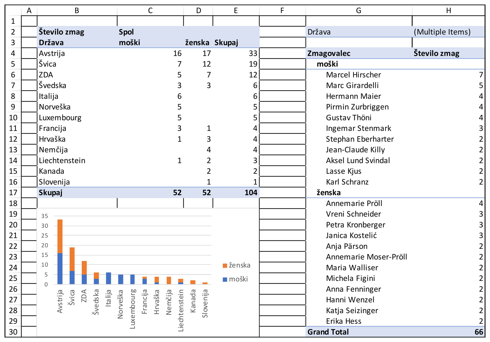
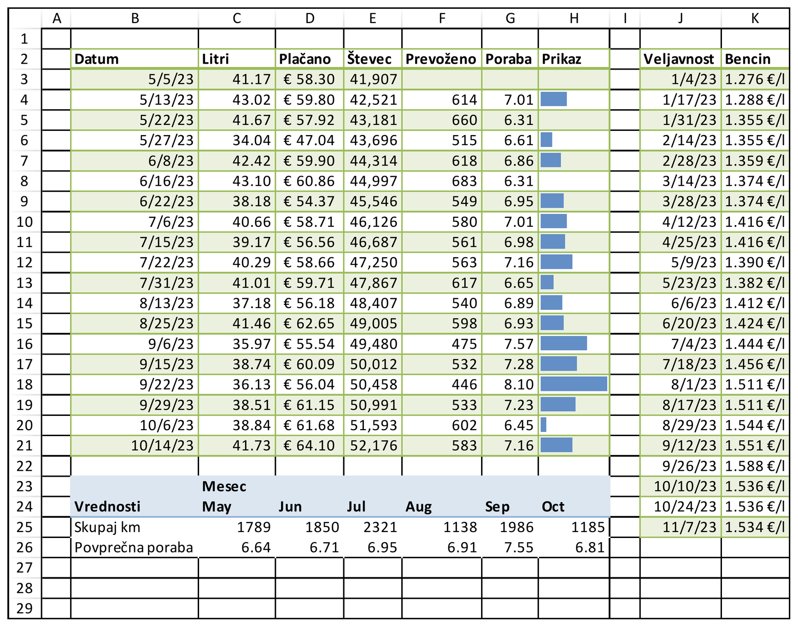
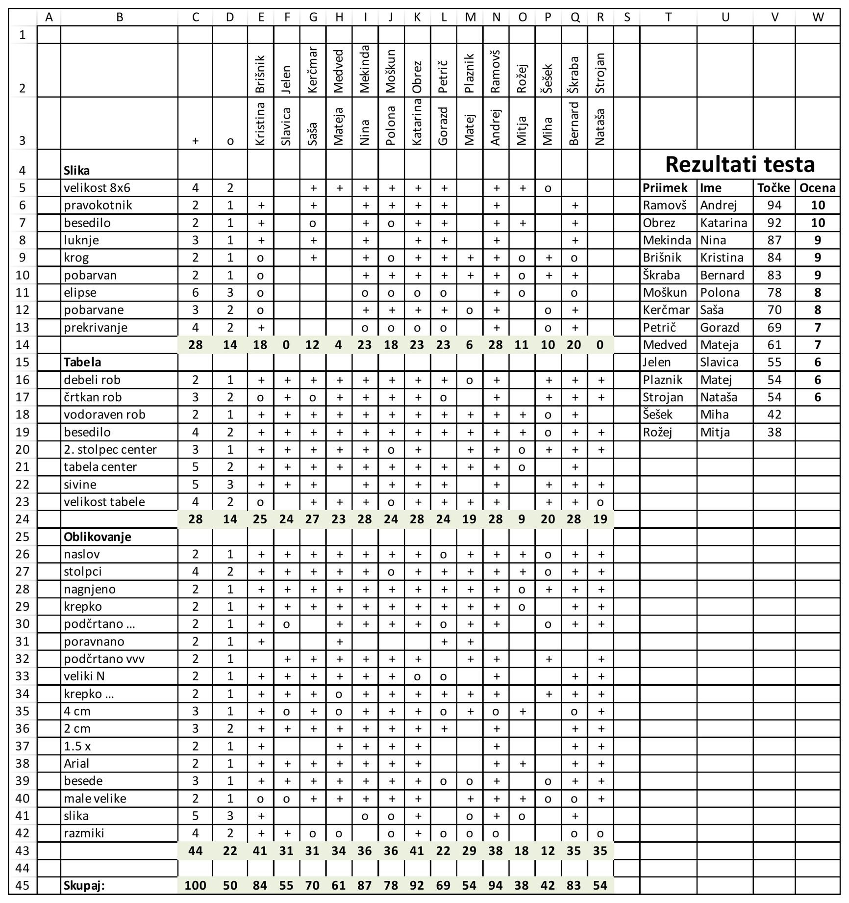

# Preglednice

`````{admonition} Programska oprema
:class: important
- [Excel](namestitev:microsoft)
`````

Excel je program za delo s preglednicami (angl. _spreadsheet_); podobno delujeta Numbers na macOS in Google Sheets v spletnem brskalniku.
Datoteka Excel vsebuje delovni zvezek (angl. _workbook_), ta pa poimenovane delovne liste (angl. _worksheet_), katerih imena so na dnu okna.
List je razdeljen na vrstice, označene s števili, in stolpce, označene s črkami.
Na preseku vrstice in stolpca je celica, njen naslov pa sestavljata oznaki stolpca in vrstice, na primer `B3`.
Podatke v preglednico običajno zapišemo tako, da vsaka vrstica ustreza eni opazovani enoti, na primer študentu, vsak stolpec pa eni njeni lastnosti, na primer številu točk.

Excel ste najverjetneje že kdaj uporabljali, zato predpostavljamo, da poznate začetna poglavja [vodiča po Excelu](https://support.microsoft.com/en-us/office/what-is-excel-94b00f50-5896-479c-b0c5-ff74603b35a3) do vključno poglavja o diagramih (angl. _Charts_), od poglavja _Formulas & functions_ pa le razdelek _Overview of formulas in Excel_.
Še posebej pomembno je, da znate opravila, ki jih na kratko povzemamo spodaj.

**Vrstice, stolpci in listi.**
Vrstico ali stolpec vstavite ali izbrišete tako, da desno kliknete njegovo oznako (številko vrstice ali črko stolpca) in izberete _Insert_ ali _Delete_.
Širino stolpca spremenite tako, da povlečete desni rob njegove oznake; z dvoklikom na ta rob se stolpec razširi ravno toliko, da je vsa vsebina vidna.
Nov list dodate z gumbom `+` ob zavihkih listov na dnu okna, preimenujete ga z dvoklikom na zavihek, vrstni red listov pa spremenite tako, da zavihek povlečete.

**Izbiranje in premikanje celic.**
Obseg celic izberete tako, da povlečete od ene vogalne celice do nasprotne, ali tako, da kliknete prvo celico, nato pa s pritisnjeno tipko <kbd>Shift</kbd> še zadnjo.
S pritisnjeno tipko <kbd>Ctrl</kbd> (🍎 <kbd>Cmd</kbd>) izbiri dodate celice, ki niso sosednje.
Klik na oznako vrstice ali stolpca izbere celo vrstico ali stolpec.
Izbiro premaknete tako, da povlečete njen rob, ko se kazalec spremeni v štiri puščice.
Formule, ki se sklicujejo na premaknjene celice, se pri tem popravijo same.

**Diagrami.**
Izberite podatke skupaj z naslovi stolpcev in na zavihku _Insert_ izberite vrsto diagrama.
Ko je diagram izbran, se na traku pojavita zavihka _Chart Design_ in _Format_.
Naslove osi, legendo in oznake podatkov dodate na zavihku _Chart Design_ z ukazom _Add Chart Element_, podatke, ki jih diagram prikazuje, pa spremenite z ukazom _Select Data_.

**Zapolnjevanje celic.**
Izbrana celica ali obseg celic ima v spodnjem desnem kotu kvadratek (angl. _fill handle_).
Ko ga povlečete, Excel izbiro razširi na nove celice: posamezno vrednost kopira, zaporedje, na primer `1` in `2` ali datum, pa nadaljuje.
Formula se pri tem prilagodi novemu mestu, kot opisuje naslednji odstavek.
Dvoklik na kvadratek zapolni stolpec navzdol do zadnje vrstice s podatki v sosednjem stolpcu.

**Sklici v formulah.**
Formula se začne z znakom `=`.
Na celico se v njej sklicujete z njenim naslovom, na primer `B3`, na obseg celic pa z naslovoma zgornje leve in spodnje desne celice, ločenima z dvopičjem, na primer `B2:D10`.
Naslova vam ni treba tipkati: med pisanjem formule kliknite celico ali povlecite čez obseg.
Na celico na drugem listu se sklicujete z imenom lista in klicajem, na primer `Podatki!B3`; če ime lista vsebuje presledek, ga zapišite v enojnih narekovajih, na primer `'Rezultati 2026'!B3`.
Sklic je običajno relativen: ko formulo kopirate eno vrstico niže, se `B3` spremeni v `B4`.
Znak `$` pred oznako stolpca ali vrstice to oznako zaklene, zato se `$B$3` pri kopiranju ne spremeni, v `B$3` pa se lahko spremeni le stolpec.
Med vrstami sklica preklapljate s tipko <kbd>F4</kbd> (🍎 <kbd>Cmd</kbd>+<kbd>T</kbd>).

## Datoteke z nalogami

1. Za vajo lahko doma rešujete [uvodne naloge iz Excela](09-preglednice/excel-uvodne.zip).
2. Datoteke za vaje najdete v arhivu [`10-razpredelnice.zip`](09-preglednice/10-razpredelnice.zip).

## Rezultati

V zvezku `rezultati.xlsx` so zbrani rezultati testa, ki so ga študenti
pisali v treh skupinah.


1.  Odstranite stolpec `H` in študente uredite naraščajoče po
    priimkih.
2.  V stolpcu `F` s funkcijo `IF` sestavite formulo, ki pove, ali
    ima študent vsaj $50$ točk. V stolpcu `I` sestavite formulo, ki
    prešteje, koliko študentov je pisalo test v vsaki skupini (uporabite
    `COUNTIF`). V stolpcu `J` s funkcijo `AVERAGEIF` izračunajte
    povprečno število točk za vsako skupino. Rezultat naj bo izpisan na
    dve decimalki (ne zaokrožen).
3.  Tabelo podobno zgornji sestavite še z vrtilno tabelo. Prikažite
    udeležbo, povprečje, minimalno ter maksimalno število točk. *Namig:*
    polje Točke lahko v vrednostih vrtilne tabele uporabite več kot
    enkrat, z različnimi funkcijami združevanja.
4.  Sestavite 3D tortni diagram z udeležbo po skupinah. Odmaknite
    največji kos in dodajte oznake z udeležbo. Sestavite stolpični
    diagram s povprečji točk po skupinah za leti 2021 in 2022. Popravite
    število decimalk na navpični osi, dodajte oznake osi in legendo.
5.  Točke manjše od $50$ s pogojnim oblikovanjem pobarvajte rdeče, prav
    tako pa tudi priimke in imena študentov, ki niso opravili testa.
    *Namig:* v meniju za pogojno oblikovanje poiščite **New Rule** in izberite slog
    **Classic** ter oblikovanje s formulo: `$E3<50`.

## Smučanje (vrtilna tabela)

V datoteki `smucanje.csv` so zbrani podatki o skupnih zmagah v
svetovnem pokalu v alpskem smučanju. Podatki so ločeni z vejicami,
uporabljena je kodna tabela `UTF-8`. Podatke uvozite v delovni zvezek
`smucanje.xlsx` na list `Podatki`. 
Tabelo z uvoženimi podatki poimenujte `Zmagovalci`. 

1.  [Poglejte](https://support.microsoft.com/en-us/office/create-a-pivottable-to-analyze-worksheet-data-a9a84538-bfe9-40a9-a8e9-f99134456576), 
    kako se v Excelu naredi vrtilno tabelo.
2.  Naredite nov list `Zmage` na katerem sestavite vrtilno tabelo in diagram, 
    kot je prikazano na sliki.
    Pri izbiri podatkov za vrtilno tabelo lahko napišete kar `Podatki!Zmagovalci`.
3.  Prva vrtilna tabela naj vsebuje pregled zmag po državah in spolu
    tekmovalcev. Vrtilno tabelo poimenujte `PoDrzavah`. Tabelo uredite
    padajoče po skupnem številu zmag.
4.  Druga vrtilna tabela naj prikazuje zmagovalce iz Evrope, ki so zmagali
    vsaj dvakrat. Ustrezen filter najdete v meniju, ki vam ga odpre gumb za
    filtriranje v glavi tabele. Izberite ustrezno polje in uredite
    filtriranje po vrednost. Te razdelite na moške in ženske kot prikazuje
    slika in tabelo uredite padajoče po skupnem številu zmag.



## Poraba (`MATCH` in `INDEX`)

V delovnem zvezku `poraba.xlsx` so vpisani podatki o tem, kdaj in
koliko goriva smo dotočili v avto. Predpostavite, da gorivo vedno
dotočimo do polnega.

1.  Izračunajte prevožene kilometre (pri tem izpustite prvo vrstico).
    Gumbe v glavi tabele lahko skrijete na zavihku *Table* (možnost
    *Filter Button*).
2.  S pomočjo funkcij `MATCH` in `INDEX` izračunajte ceno natočenega
    goriva.
3.  Porabo (litre na 100 km) izračunate po formuli
    $100 \cdot \frac{\text{litri}}{\text{prevoženo}}$.
4.  V zadnjem stolpcu grafično prikaži porabo. S formulo kopirajte
    vrednost iz stolpca Poraba. Za zadnji stolpec uporabite pogojno
    oblikovanje: **Conditional Formatting** > **Highest Value**. 
    Za *minimum* in *maksimum* iz menija izberite *Lowest
    Value* in *Highest Value*.
5.  Sestavite vrtilno tabelo s pregledom prevoženih kilometrov in porabe
    po mesecih. Stolpec skupno lahko skrijete na zavihku *Design*.



## Točkovanje (dodatna naloga)

V delovnem zvezku `tockovanje.xlsx` so zbrani podatki o točkovanju
testa, ki so ga pisali študenti. Vsaka naloga je bila točkovana s
plusom, krogcem ali minusom (minusi v tabelo niso vpisani), vrednosti
plusa in krogca pa so različne pri posameznih nalogah.



1.  Stolpce uredite tako, da bodo priimki študentov urejeni po abecednem
    vrstnem redu: **Data** > **Sort**, pod **Options** pa izberete **Sort from left to right**. 
    Ni nujno, da se bodo šumniki uredili pravilno, to je za zdaj ok.
2.  Na obarvanih poljih (vrstice 14, 24, 43 in 45), izračunajte dosežene
    točke s funkcijama `SUM` in `SUMIF`. Formule najprej sestavite
    za enega študenta in jih kopirajte k drugim.
3.  Pod "Rezultati testa" kopirajte imena, priimke in dosežene
    točke (vrednosti, ne formul): uporabite menija **Copy** in **Paste Special**.
4.  Študente uredite padajoče po doseženih točkah in izračunajte ocene.

