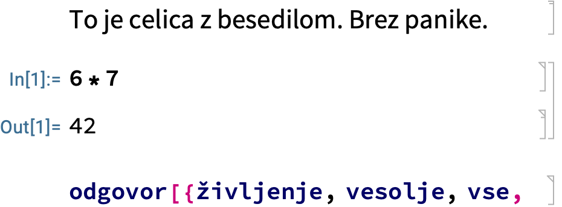
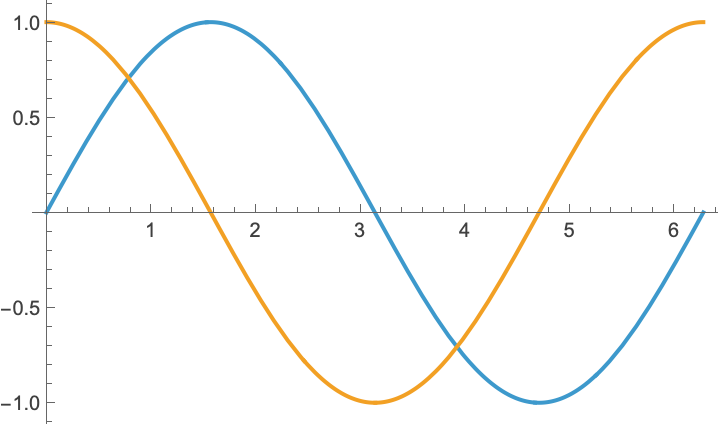

# Osnovna uporaba Mathematice

`````{admonition} Programska oprema
:class: important
- [Mathematica](namestitev:mathematica)
`````

Mathematica je program za simbolno računanje, kar med drugim pomeni, da poleg običajnega računanja s števili zna integrirati, računati limite, risati grafe in še kaj.

## Uporabniški vmesnik

Z Mathematico delate v oknu zvezka (angl. _notebook_).
Vsak zvezek je sestavljen iz celic, te pa so treh vrst: celice z besedilom (angl. _text cell_), vhodne celice (angl. _input cell_) in izhodne celice (angl. _output cell_).
Vse tri kaže {numref}`slika %s <slika:celice>`.

:::{figure-md} slika:celice
:width: 60%
:align: center


&nbsp; Celice v zvezku: besedilo, izveden izraz z rezultatom in nedokončan izraz
:::

Na vrhu je celica z besedilom, napisana v običajni pisavi.

Pod njo je vhodna celica z izrazom `6*7`.
Vhodne celice prepoznate po krepki pisavi, v kateri so vsi znaki enako široki.
Ta celica je že izvedena, zato ima oznako `In[1]:=`.
Pod njo je izhodna celica z rezultatom `42` in oznako z isto številko, `Out[1]=`.

Zadnja celica na sliki je vhodna, a še ni izvedena, zato nima oznake.
Izraz v njej ni dokončan: Mathematica obarva oklepaja, ki nimata para, in vejico, za katero ni ničesar.

**Nova celica.**
Novo vhodno celico dodate tako, da kliknete v prostor pod celico ali med dve celici, kjer se pojavi vodoravna črta, in začnete tipkati.
Celica nastane šele, ko napišete prvi znak.
Če želite celico z besedilom, kliknite na isto mesto in pred tipkanjem pritisnite <kbd>Alt</kbd>+<kbd>7</kbd> (🍎 <kbd>Cmd</kbd>+<kbd>7</kbd>) ali v meniju izberite **Format** > **Style** > **Text**.

`````{admonition} Pozor pri kopiranju izrazov
:class: warning
Če izraz (na primer enačbo) kopirate iz celice z besedilom ali iz datoteke PDF, so nekateri znaki pogosto napačni in Mathematica celice ne more izvesti.
`````

**Izvajanje.**
Vhodno celico izvedete s tipkama <kbd>Shift</kbd>+<kbd>Enter</kbd>.
Celica dobi oznako s številko, pod njo pa se pokaže izhodna celica z rezultatom, kot na {numref}`sliki %s <slika:celice>`.
V eno celico lahko napišete več izrazov, vsakega v svojo vrstico; Mathematica izpiše rezultat vsakega posebej.

Številka v oznakah `In` in `Out` pove, katero po vrsti ste celico izvedli.
Mathematica si zapomni vse, kar ste izvedli, zato šteje vrstni red izvajanja in ne vrstni red celic v zvezku.

Izvajanje prekinete s tipkama <kbd>Alt</kbd>+<kbd>.</kbd> (🍎 <kbd>Cmd</kbd>+<kbd>.</kbd>) ali z **Evaluation** > **Abort Evaluation**.
Če to ne pomaga, ustavite jedro z **Evaluation** > **Quit Kernel** > **Local**.

**Izbiranje in brisanje celic.**
Na desnem robu zvezka ima vsaka celica oglat zaklepaj (angl. _cell bracket_).
Vhodno celico in njen rezultat združuje v skupino še en, zunanji zaklepaj.
S klikom na zaklepaj izberete celico, s klikom na zunanji zaklepaj pa celo skupino.
Kar ste izbrali, izbrišete s tipko <kbd>Backspace</kbd>; če izberete skupino, tako izbrišete vhodno celico in njen rezultat hkrati.
Z dvojnim klikom na zunanji zaklepaj skupino zaprete ali odprete: zaprta skupina kaže samo vhodno celico.

**Posebni znaki in grške črke.**
Grške črke in druge posebne znake napišete s kratkim imenom (angl. _alias_) med dvema pritiskoma tipke <kbd>Esc</kbd>: črko alfa na primer kot <kbd>Esc</kbd> `a` <kbd>Esc</kbd>.
Po prvem pritisku se v celici pokaže znak `⋮`, po drugem pa se zapis spremeni v želeni znak.
Več o tem preberite v [dokumentaciji](https://reference.wolfram.com/language/howto/TypeAGreekLetter.html).

**Dokumentacija.**
Mathematica ima več tisoč vgrajenih funkcij.
Najpogostejše si boste zapomnili, ostale pa se naučite poiskati.
Kratek opis funkcije dobite z vprašajem pred njenim imenom, na primer `?Plot`.
Celotno dokumentacijo odprete s **Help** > **Wolfram Documentation**.
Primeri v njej so celice, ki jih lahko spremenite in izvedete.

## Osnovna sintaksa

Matematične izraze pišete precej podobno kot v LaTeXu: `x^2` ostane `x^2`, `\sin x` pa postane `Sin[x]`.
Množenje zapišete z zvezdico ali s presledkom: `2 x` in `a b` sta produkta.
Zapis `ab` brez presledka je en sam simbol z imenom `ab`.

**Oklepaji.**

* Z okroglimi oklepaji združujete dele izraza, kot v matematiki: `(1 + 2)*3`.
* V oglatih oklepajih naštejete argumente funkcije, ločene z vejicami: `f[x, y, z]`.
* V zavitih oklepajih zapišete sezname (`{1, 2, 3}`), koordinate točk (`{Cos[x], Sin[x]}`) in množice (`{rdeča, zelena, modra}`).

**Imena.**
Vgrajene funkcije in konstante se začnejo z veliko začetnico: `Sin[x]` je sinus, `sin` pa je za Mathematico neznano ime.
Najpogostejše konstante so `Pi`, `E`, imaginarna enota `I` in neskončnost `Infinity`.

**Barve.**
Mathematica imena v vhodnih celicah barva, zato napako pogosto opazite, še preden celico izvedete:

* Modra so imena, ki jih Mathematica ne pozna, na primer `sin`. Modro ime je torej vaše lastno ali pa tipkarska napaka.
* Črna so imena, ki jih pozna: ko `sin` popravite v `Sin`, počrni.
* Zelene so spremenljivke, ki veljajo samo znotraj enega izraza, na primer `k` v vsoti `Sum[1/k^2, {k, 1, Infinity}]`.
* Vijoličen je oklepaj brez para, kot na {numref}`sliki %s <slika:celice>`.

## Računanje

Mathematico lahko uporabljate kot kalkulator, vendar zna več: računa natančno in tudi z izrazi, v katerih nastopajo simboli.
Rezultate poimenujete, vanje vstavljate vrednosti in iz njih sestavljate funkcije.

**Natančno in numerično računanje.**
Mathematica računa natančno, dokler ne zahtevate drugače.
{numref}`Slika %s <slika:natancno-racunanje>` kaže, kaj dobite, če izvedete celici z izrazoma `1/3 + 1/6` in `Sqrt[8]`.

:::{figure-md} slika:natancno-racunanje
:width: 60%
:align: center
![Izvedeni celici z izrazoma 1/3 + 1/6 in Sqrt[8] ter rezultatoma 1/2 in 2 Sqrt[2]](10-osnove-mathematice/natancno-racunanje.png)

&nbsp; Natančna rezultata: ulomek in izraz s korenom
:::

Rezultata sta ulomek in izraz s korenom, ne decimalna približka.
Numerično vrednost izračuna funkcija `N`, ki ji kot drugi argument lahko podate število mest: `N[Pi, 20]` vrne `3.1415926535897932385`.
Numeričen je tudi rezultat vsakega izraza, v katerem nastopa število z decimalno piko: `1/3.` vrne `0.333333`.

**Odvodi, integrali, vsote in limite.**

| | Vnos | Rezultat |
|---|---|---|
| odvod | `D[x^3, x]` | `3 x^2` |
| nedoločeni integral | `Integrate[x^2, x]` | `x^3/3` |
| določeni integral | `Integrate[x^2, {x, 0, 1}]` | `1/3` |
| vsota | `Sum[k, {k, 1, 100}]` | `5050` |
| limita | `Limit[Sin[x]/x, x -> 0]` | `1` |

Nedoločenemu integralu Mathematica ne pripiše konstante.
Seznam `{x, 0, 1}` v določenem integralu pove, da `x` teče od `0` do `1`.
Enak seznam določa meje vsote, `{k, 1, 100}`, pri risanju grafov pa interval.

**Spremenljivke.**
Z enačajem priredimo izrazu ali vrednosti ime:

```
g = 9.81
polinom = x^2 + 1
```

Odslej Mathematica ime `polinom` povsod nadomesti z izrazom `1 + x^2` (člene uredi po svoje), zato `D[polinom, x]` vrne `2 x`.
Svoja imena pišite z malo začetnico, da jih ne zamenjate z vgrajenimi.
Če vrstico končate s podpičjem, Mathematica njenega rezultata ne izpiše.

Ime velja, dokler ga ne počistite s funkcijo `Clear`, na primer `Clear[polinom]`, ali ne ustavite jedra.
Velja v vseh celicah in tudi v drugih odprtih zvezkih.

**Prepisovalna pravila.**
Vrednost izraza pri $x = 3$ izračunate s _prepisovalnim pravilom_ (angl. _rule_):

```
polinom /. x -> 3
```

Rezultat je `10`.
Pravilo `x -> 3` pomeni »`x` zamenjaj s `3`«, operator `/.` pa pravilo uporabi na izrazu, ki stoji pred njim.
Puščico napišete z znakoma `-` in `>`, Mathematica pa ju sama združi v `→`.

Pravilo velja samo za ta izračun: `x` je po njem še vedno simbol brez vrednosti, `polinom` pa še vedno `1 + x^2`.
Zato lahko takoj zatem vstavite drugo vrednost ali izraz odvajate:

```
polinom /. x -> 5
D[polinom, x]
```

Dobite `26` in `2 x`.

Drugače je, če vrednost vstavite z enačajem:

```
x = 3
polinom
```

Tudi tako dobite `10`, vendar ste s tem spremenili `x`: odslej ima vrednost `3` povsod, v vseh celicah, dokler ga ne počistite.
Mathematica zato `polinom` povsod prebere kot `10` in v njem ni več nobenega `x`, s katerim bi lahko računali.
Vrstica `polinom /. x -> 5` zdaj brez opozorila vrne `10` in ne `26`.

`````{admonition} Vrednosti ne vstavljajte z enačajem
:class: warning
Ko ima `x` vrednost `3`, Mathematica vrstico `D[polinom, x]` prebere kot `D[10, 3]` in javi napako »3 is not a valid variable«.
V celici, ki javi napako, ni nič narobe: vzrok je vrstica `x = 3`, ki ste jo izvedli prej.

Da ima simbol vrednost, vidite po barvi: `x` je črn in ne moder.
Vrednost počistite s `Clear[x]`.
`````

Z enačajem torej stvari poimenujete, s pravili pa vstavljate vrednosti.

Simbol lahko zamenjate tudi z izrazom: `polinom /. x -> t + 1` vrne `1 + (1 + t)^2`.
Več simbolov hkrati zamenjate s seznamom pravil.
Tako v isto formulo vstavite različne nabore vrednosti:

```
diskriminanta = b^2 - 4 a c
diskriminanta /. {a -> 1, b -> -3, c -> 2}
diskriminanta /. {a -> 1, b -> 2, c -> 5}
```

Zadnji dve vrstici vrneta `1` in `-16`, simboli `a`, `b` in `c` pa ostanejo brez vrednosti.

Pravila ste že srečali v limiti, `Limit[Sin[x]/x, x -> 0]`, in jih boste še pri risanju.

**Funkcije.**
Kadar boste v isti izraz vrednosti vstavljali večkrat, definirajte funkcijo:

```
f[x_] := x^2 + 1
```

Na levi strani definicije za vsako spremenljivko napišete podčrtaj, na desni pa ne.
V tem poglavju je dovolj, da ga vedno napišete; kaj natančno pomeni, tu ni pomembno.
Funkcije definirajte z operatorjem `:=` in ne z enačajem: desna stran se tako izračuna šele, ko funkcijo pokličete.

Zdaj `f[3]` vrne `10`, `f[t + 1]` vrne `1 + (1 + t)^2`, `f'[x]` pa odvod `2 x`.

Če podčrtaj pozabite, funkcija ne deluje: `f[3]` ostane `f[3]`.

## Risanje

Mathematica nariše dve vrsti slik: grafe, ki jih izračuna iz predpisa funkcije, in slike, ki jih sami sestavite iz geometrijskih objektov.

**Grafi funkcij.**
Graf funkcije nariše funkcija `Plot`:

```
Plot[x^2, {x, -2, 2}]
```

Drugi argument, `{x, -2, 2}`, pove, da `x` teče od `-2` do `2`, enako kot pri določenem integralu.
Narišete lahko izraz, funkcijo, ki ste jo definirali, ali več grafov hkrati, če jih naštejete v seznamu:

```
Plot[f[x], {x, -2, 2}]
Plot[{Sin[x], Cos[x]}, {x, 0, 2 Pi}]
```

Druga vrstica nariše oba grafa v isto sliko, vsakega v svoji barvi, kot kaže {numref}`slika %s <slika:graf-sinus-kosinus>`.

:::{figure-md} slika:graf-sinus-kosinus
:width: 50%
:align: center


&nbsp; Grafa sinusa in kosinusa v isti sliki
:::

Videz grafa določite z nastavitvami (angl. _options_).
Nastavitve so pravila, ki jih naštejete za drugim argumentom:

```
Plot[f[x], {x, -2, 2}, PlotRange -> {0, 3}]
```

Nastavitev `PlotRange` določi, kateri del navpične osi je prikazan.
Ostale nastavitve so naštete v dokumentaciji funkcije `Plot`.

**Geometrijski objekti.**
Slike, ki niso grafi funkcij, sestavite iz geometrijskih objektov s funkcijo `Graphics`:

```
Graphics[{Circle[{0, 0}, 1], Point[{1, 0}], Line[{{-1, 0}, {0, 1}}]}]
```

Objekte naštejete v seznamu, točko pa podate kot seznam dveh koordinat, na primer `{1, 0}`:

* `Circle[{0, 0}, 1]` je krožnica s središčem `{0, 0}` in polmerom `1`.
* `Point[{1, 0}]` je točka.
* `Line[{{-1, 0}, {0, 1}}]` je daljica med točkama; z več točkami v seznamu dobite lomljenko.

Barvo objektov in velikost točk določite tako, da ju v seznamu napišete pred objekt, na primer `Red` ali `PointSize[Large]`; veljata za vse objekte, ki sledijo.
Koordinatni osi doda nastavitev `Axes`:

```
Graphics[{Circle[{0, 0}, 1], Red, PointSize[Large], Point[{1, 0}]}, Axes -> True]
```

Rezultat kaže {numref}`slika %s <slika:kroznica-tocka>`.

:::{figure-md} slika:kroznica-tocka
:width: 35%
:align: center


&nbsp; Krožnica z rdečo točko in koordinatnima osema
:::

Druge objekte, na primer `Disk`, `Rectangle` in `Triangle`, najdete v dokumentaciji funkcije `Graphics`.

## Naloga

Rešujte naloge v [zvezku](10-osnove-mathematice/mathematica1.nb).
