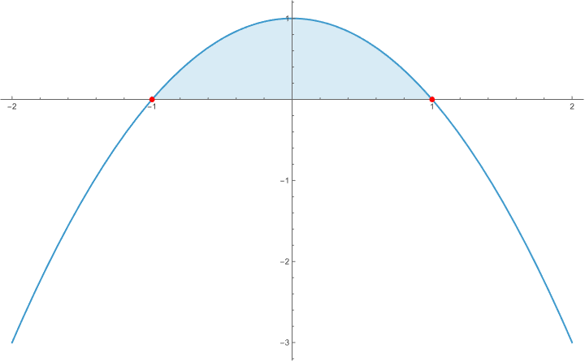

# Mathematica 2

`````{admonition} Programska oprema
:class: important
- [Mathematica](namestitev:mathematica)
`````

V tem poglavju boste znanje iz prejšnjega poglavja uporabili na zahtevnejših primerih.

## Enačbe in neenačbe

Enačbe in sisteme enačb rešujete s funkcijo `Solve`, ki sprejme dva argumenta.
V prvem podate enačbo ali seznam enačb, v drugem pa neznanko ali seznam neznank, ki jih iščete.

```mathematica
In:= enacba = x^2 - 5 x + 6 == 0
Out= 6 - 5 x + x^2 == 0

In:= resitve = Solve[enacba, x]
Out= {{x -> 2}, {x -> 3}}
```

Rezultat je seznam rešitev, v katerem je vsaka rešitev zapisana s prepisovalnim pravilom. Rešitve torej lahko uporabite enako kot prepisovalna pravila v prejšnjem poglavju, z operatorjem `/.`:

```mathematica
In:= x /. resitve
Out= {2, 3}

In:= enacba /. resitve
Out= {True, True}
```

V `In[4]` smo na desni strani prepisovalnega pravila podali seznam, zato Mathematica izračuna vrednost izraza na levi za vsako rešitev posebej.

Sistem enačb zapišete kot seznam enačb, neznanke pa kot seznam neznank:

```mathematica
In:= sistem = {x + y == 5, x - y == 1}
Out= {x + y == 5, x - y == 1}

In:= resitev = Solve[sistem, {x, y}]
Out= {{x -> 3, y -> 2}}
```

V tem primeru je rezultat je ena rešitev, ki določa obe neznanki.
Tu se vidi, zakaj `Solve` ne vrača samo številskih rešitev: prepisovalna pravila nam povedo, kateri neznanki pripada katera vrednost.
Če želimo dobiti samo vrednosti obeh neznank, lahko prepisovalni pravili uporabimo na seznamu neznank:

```mathematica
In:= {x, y} /. resitev
Out= {{3, 2}}
```

`Solve` poišče vse rešitve, tudi kompleksne.
Če želite samo realne rešitve, dodajte tretji argument `Reals`.

```mathematica
In:= Solve[x^3 == 8, x, Reals]
Out= {{x -> 2}}
```

Za kvadratno enačbo poznate obrazec, ki rešitve izrazi z osnovnimi računskimi operacijami in kvadratnim korenom.
Za enačbe pete in višjih stopenj takega obrazca v splošnem ni, zato `Solve` rešitev včasih le opiše:

```mathematica
In:= Solve[x^5 - x - 1 == 0, x, Reals]
Out= {{x -> Root[-1 - #1 + #1^5 &, 1]}}
```

Rezultat pomeni »najmanjša realna ničla polinoma $-1 - x + x^5$«, pri čemer `#1` stoji namesto neznanke.
Številski približek izračuna funkcija `NSolve`, ki podobno kot `Solve` sprejme argument `Reals`:

```mathematica
In:= priblizek = NSolve[x^5 - x - 1 == 0, x, Reals]
Out= {{x -> 1.1673}}

In:= x^5 - x - 1 /. priblizek
Out= {4.44089*10^-16}
```

Ko približek vstavite v levo stran enačbe, ne dobite natanko `0`, temveč zelo majhno število: `NSolve` računa s približki, tako kot `N` v prejšnjem poglavju.

`Solve` in `NSolve` sta namenjena predvsem polinomskim enačbam.
Za druge enačbe, na primer $\cos x = x$, uporabite `FindRoot`, ki poišče eno rešitev blizu začetnega približka:

```mathematica
In:= FindRoot[Cos[x] == x, {x, 1}]
Out= {x -> 0.739085}
```

V seznamu `{x, 1}` je `1` začetni približek.
Ker je rešitev ena sama, rezultat ni seznam rešitev, temveč seznam prepisovalnih pravil, zato z `/.` dobite kar število:

```mathematica
In:= x /. FindRoot[Cos[x] == x, {x, 1}]
Out= 0.739085
```

Če ima enačba več rešitev, jih poiščete z različnimi začetnimi približki.

Neenačbe rešuje funkcija `Reduce`:

```mathematica
In:= pogoj = Reduce[x^2 - 5 x + 6 < 0, x]
Out= 2 < x < 3

In:= Reduce[x^2 - 5 x + 6 > 0, x]
Out= x < 2 || x > 3
```

V drugem rezultatu `||` pomeni »ali«.
Rezultat `Reduce` ni prepisovalno pravilo, temveč pogoj, ki ga mora izpolnjevati `x`.
Vanj lahko z `/.` vstavite vrednosti, enako kot v enačbo:

```mathematica
In:= pogoj /. {{x -> 1}, {x -> 5/2}, {x -> 3}}
Out= {False, True, False}
```

Vrednost `3` pogoja ne izpolnjuje, ker je neenačba stroga.

## Delo s seznami

Funkcijo `Table` ste spoznali v prejšnjem poglavju.
Korak lahko podate kot četrti element seznama, vrednosti spremenljivke pa lahko tudi naštejete:

```mathematica
In:= Table[n^2, {n, 0, 1, 0.25}]
Out= {0., 0.0625, 0.25, 0.5625, 1.}

In:= Table[n^2, {n, {2, 3, 7}}]
Out= {4, 9, 49}
```

Izraz v tabeli je lahko karkoli, kar ste spoznali do zdaj, tudi rešitev enačbe ali graf:

```mathematica
In:= Table[x /. Solve[x^2 == a, x], {a, 1, 4}]
Out= {{-1, 1}, {-Sqrt[2], Sqrt[2]}, {-Sqrt[3], Sqrt[3]}, {-2, 2}}

In:= Table[Plot[x^n, {x, -1, 1}], {n, 1, 4}]
```

Prvi primer vrne rešitve enačbe $x^2 = a$ za štiri vrednosti parametra $a$, drugi pa nariše štiri grafe drugega ob drugem.

Seznam zaporednih celih števil vrne funkcija `Range`.
Funkcija `Select` iz seznama izbere elemente, ki izpolnjujejo pogoj, `Length` pa vrne dolžino seznama:

```mathematica
In:= Range[10]
Out= {1, 2, 3, 4, 5, 6, 7, 8, 9, 10}

In:= prastevila = Select[Range[50], PrimeQ]
Out= {2, 3, 5, 7, 11, 13, 17, 19, 23, 29, 31, 37, 41, 43, 47}

In:= Length[prastevila]
Out= 15
```

Drugi argument funkcije `Select` je pogoj: funkcija, ki za vsak element vrne `True` ali `False`.
Takim funkcijam pravimo predikati.
Imena vgrajenih predikatov se končajo s `Q` (angl. _question_), na primer `PrimeQ`, `EvenQ` in `OddQ`.
Svoj predikat definirate kot vsako drugo funkcijo:

```mathematica
In:= ostanek1[n_] := Mod[n, 4] == 1

In:= Select[prastevila, ostanek1]
Out= {5, 13, 17, 29, 37, 41}
```

`Mod[n, 4]` je ostanek pri deljenju `n` s `4`, zato `Select` izbere praštevila, ki dajo pri deljenju s `4` ostanek `1`.

Funkcija `Map` uporabi funkcijo na vsakem elementu seznama.
Namesto `Map[f, seznam]` lahko pišete tudi `f /@ seznam`:

```mathematica
In:= delitelji = Map[Divisors, {12, 18, 30}]
Out= {{1, 2, 3, 4, 6, 12}, {1, 2, 3, 6, 9, 18}, {1, 2, 3, 5, 6, 10, 15, 30}}

In:= Length[delitelji]
Out= 3

In:= Length /@ delitelji
Out= {6, 6, 8}
```

`Length[delitelji]` prešteje elemente seznama `delitelji`, torej tri sezname, `Length /@ delitelji` pa elemente vsakega od njih.
Mnoge funkcije, na primer računske operacije, same delujejo po elementih, kot ste videli v prejšnjem poglavju; `Map` potrebujete za tiste, ki tega ne počnejo.

Posamezen element seznama vrne funkcija `Part`.
Prvi argument je seznam, drugi pa mesto elementa v njem:

```mathematica
In:= Part[prastevila, 3]
Out= 5
```

Običajno jo zapišete krajše, z dvojnimi oglatimi oklepaji za seznamom:

```mathematica
In:= prastevila[[3]]
Out= 5

In:= resitve[[2]]
Out= {x -> 3}

In:= x /. resitve[[2]]
Out= 3
```

Elementi so oštevilčeni od `1` naprej.
Ime `resitve` ima še vedno vrednost iz začetka poglavja, zato `resitve[[2]]` vrne drugo rešitev enačbe, z `/.` pa njeno vrednost.

## Definicije funkcij z vzorci

Podčrtaj na levi strani definicije funkcije (na primer `f[x_] := x^2 + 1` iz prejšnjega poglavja) pomeni, da je `x_` vzorec: ujema se s katerimkoli argumentom, Mathematica pa na desni strani vsak `x` zamenja s tem argumentom.
Definicija funkcije je prepisovalno pravilo, kakršna ste že uporabljali z `/.`.
Tega prepisovalnega pravila vam ni treba uporabiti z `/.`, ker ga Mathematica uporabi sama: vsak izraz, ki se ujema z levo stranjo, nadomesti z desno.
Za isto funkcijo lahko podate več prepisovalnih pravil, na primer posebej za izbrane vrednosti argumenta:

```mathematica
In:= fib[1] := 1

In:= fib[2] := 1

In:= fib[n_] := fib[n - 1] + fib[n - 2]

In:= Table[fib[n], {n, 1, 10}]
Out= {1, 1, 2, 3, 5, 8, 13, 21, 34, 55}
```

Mathematica najprej poskusi prepisovalna pravila za izbrane vrednosti in šele nato splošno prepisovalno pravilo, zato se računanje pri `fib[1]` in `fib[2]` ustavi.

Vzorec ima lahko tudi obliko.
Če je argument točka, ga zapišete kot seznam dveh vzorcev:

```mathematica
In:= razdalja[{x1_, y1_}, {x2_, y2_}] := Sqrt[(x2 - x1)^2 + (y2 - y1)^2]

In:= razdalja[{0, 0}, {3, 4}]
Out= 5

In:= razdalja[{0, 0}, 5]
Out= razdalja[{0, 0}, 5]
```

Če se argument z vzorcem ne ujema, Mathematica izraza ne izračuna, tako kot `f[3]` v prejšnjem poglavju, ko ste pozabili podčrtaj.

Vzorec se lahko ujema tudi z obliko izraza.
Spodnja funkcija `odvod` ima prepisovalno pravilo za potence, za sinus in za vsoto:

```mathematica
In:= odvod[x^n_] := n x^(n - 1)

In:= odvod[Sin[x]] := Cos[x]

In:= odvod[u_ + v_] := odvod[u] + odvod[v]

In:= odvod[x^3 + Sin[x]]
Out= 3 x^2 + Cos[x]

In:= odvod[Cos[x]]
Out= odvod[Cos[x]]
```

Argument `x^3 + Sin[x]` se ujema z vzorcem `u_ + v_`, zato `odvod` odvaja vsak sumand posebej, vsak sumand pa se ujema z enim od preostalih dveh prepisovalnih pravil.
Za kosinus prepisovalnega pravila ni, zato `odvod[Cos[x]]` ostane neizračunan.

```mathematica
In:= odvod[x^2 + x]
Out= 2 x + odvod[x]
```

Sumand `x` se z vzorcem `x^n_` ne ujema, čeprav je matematično enak `x^1`: vzorec primerja obliko izraza, ne njegove vrednosti.
Manjkajoče prepisovalno pravilo dodate brez podčrtaja, da se ujema le s simbolom `x`:

```mathematica
In:= odvod[x] := 1

In:= odvod[x^2 + x]
Out= 1 + 2 x
```

S podčrtajem bi se prepisovalno pravilo ujemalo s čimer koli:

```mathematica
In:= odvod[x_] := 1

In:= odvod[Cos[x]]
Out= 1
```

Mathematica še vedno najprej poskusi bolj določena prepisovalna pravila, zato `odvod[x^3 + Sin[x]]` še vedno vrne `3 x^2 + Cos[x]`.
Za kosinus pa namesto neizračunanega izraza zdaj dobite napačen rezultat `1`.

Vsa prepisovalna pravila, ki jih ima funkcija, izpiše `?odvod`.
Nova definicija z enako levo stranjo staro zamenja, definicija z drugačno levo stranjo pa doda novo prepisovalno pravilo.
Napačno prepisovalno pravilo `odvod[x_] := 1` zato ostane, dokler ne pobrišete vseh prepisovalnih pravil funkcije s `Clear[odvod]`.

Funkcija `odvod` odvaja le po `x`, ker je simbol `x` zapisan v njenih prepisovalnih pravilih.
Za odvod po drugi spremenljivki to spremenljivko podate kot drugi argument in jo v prepisovalnih pravilih zapišete z vzorcem:

```mathematica
In:= Clear[odvod]

In:= odvod[y_^n_, y_] := n y^(n - 1)

In:= odvod[Sin[y_], y_] := Cos[y]

In:= odvod[u_ + v_, y_] := odvod[u, y] + odvod[v, y]

In:= odvod[t^3 + Sin[t], t]
Out= 3 t^2 + Cos[t]
```

Ime `y_` se v vsakem prepisovalnem pravilu pojavi dvakrat.
Vzorec se ujema le, če se obe pojavitvi ujemata z istim izrazom, zato prepisovalno pravilo za potence odvaja `t^3` po `t`, ne pa po `x`.

## Takojšnje in zakasnjeno prirejanje

Simbolu lahko vrednost priredite z enojnim enačajem `=` ali z `:=`.
Pri `=` Mathematica desno stran izračuna takoj in si zapomni rezultat.
Pri `:=` si zapomni desno stran, kot je zapisana, izračuna pa jo vsakič, ko simbol uporabite.
Razliko pokaže funkcija `RandomInteger`, ki ob vsakem klicu vrne novo naključno število:

```mathematica
In:= a = RandomInteger[{0, 10}]
Out= 7

In:= {a, a, a}
Out= {7, 7, 7}

In:= b := RandomInteger[{0, 10}]

In:= {b, b, b}
Out= {10, 8, 2}
```

Simbol `a` je dobil eno naključno število, simbol `b` pa ob vsaki uporabi izbere novo.
Vaša števila bodo drugačna.

Zato funkcije definirate s `:=`.
Z `=` bi Mathematica desno stran izračunala že ob definiciji, in če bi `x` takrat imel vrednost, bi jo vstavila:

```mathematica
In:= x = 2
Out= 2

In:= g[x_] = x^2 + 1
Out= 5

In:= g[10]
Out= 5

In:= h[x_] := x^2 + 1

In:= h[10]
Out= 101

In:= Clear[x]
```

Funkcija `g` vrne `5` pri vsakem argumentu, ker je desna stran postala `5`, še preden je Mathematica shranila prepisovalno pravilo.
Funkcija `h` desno stran izračuna šele, ko jo uporabite, in sicer z argumentom namesto `x`.

Dvojni enačaj `==` pa je nekaj povsem drugega: ne priredi ničesar, temveč primerja levo in desno stran.
`2 + 2 == 4` vrne `True`, `x^2 == 4` pa ostane enačba, ker `x` nima vrednosti, in prav takšno enačbo podate funkciji `Solve`.

## Več o grafih

Graf lahko dopolnite z nastavitvami in ga združite z drugimi slikami.
Nastavitev `Epilog` grafu doda geometrijske objekte, ki jih zapišete enako kot v funkciji `Graphics`.
Nastavitev `Filling -> Axis` pobarva območje med grafom in abscisno osjo:

```mathematica
In:= graf1 = Plot[1 - x^2, {x, -2, 2},
  Epilog -> {Red, PointSize[Large], Point[{{-1, 0}, {1, 0}}]}]

In:= graf2 = Plot[1 - x^2, {x, -1, 1}, Filling -> Axis]
```

Funkcija `Point` s seznamom točk nariše vse točke hkrati.
Ploščino pobarvanega območja izračuna `Integrate`:

```mathematica
In:= Integrate[1 - x^2, {x, -1, 1}]
Out= 4/3
```

Določeni integral je ploščina le, kjer graf leži nad osjo; pod osjo je integral negativen.

Funkcija `Show` nariše več slik v isti koordinatni sistem:

```mathematica
In:= Show[graf1, graf2]
```

Rezultat kaže {numref}`slika %s <slika:graf-nicle-ploscina>`.
`Show` vzame interval in nastavitve od prve slike, zato je prikazan cel interval od `-2` do `2`.
V `Show` lahko sestavite tudi grafe in slike iz funkcije `Graphics`.

:::{figure-md} slika:graf-nicle-ploscina
:width: 50%
:align: center


&nbsp; Graf z označenima ničlama in pobarvanim območjem
:::

## Naloge iz več korakov

Mathematica si zapomni vse, kar ste izvedli, zato lahko ime iz ene naloge pokvari drugo.
Pri nalogah iz več korakov se tega obvarujete z dvema navadama:

* Vsako nalogo rešite v svoji celici in celico začnite s `Clear` za vsa imena, ki jih v njej definirate, na primer `Clear[prastevila, ostanek1]`.
  Tako se celica vsakič izvede enako, tudi ko jo po popravku izvedete znova, in v njej ne ostanejo stara prepisovalna pravila, kot napačno prepisovalno pravilo funkcije `odvod`.
* Dolge klice razdelite v več vrstic, vsako nastavitev v svojo, kot pri `graf1` zgoraj.
  Manjkajočo vejico ali oklepaj tako najdete hitreje.

## Naloge

Rešite naloge v [zvezku](11-mathematica-2/mathematica2.nb).
